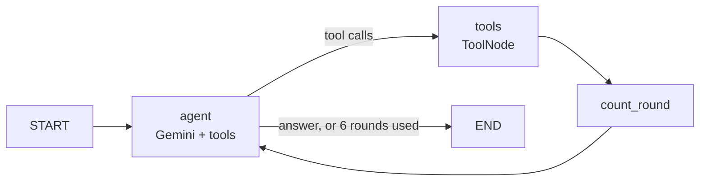

# Mutual Fund Research Agent

[](https://github.com/rahulmaity0/mf-research-agent/actions/workflows/ci.yml)

A LangGraph agent that answers questions about Indian mutual funds, like *"which flexi cap
fund had the lowest volatility last year, and how did its return move since April?"*, using
data from my [mf-analytics-pipeline](https://github.com/rahulmaity0/mf-analytics-pipeline).

The LLM (Gemini) decides which lookups to make and writes the answer. It doesn't produce
the numbers: every figure comes from a tool call against the pipeline's API, and the system
prompt forbids estimating or calculating anything itself.

## How it works



| Tool | Pipeline endpoint | Used for |
|---|---|---|
| `list_categories` | `GET /categories` | finding exact category names |
| `search_funds` | `GET /funds` | best/worst funds in a category by return, Sharpe or volatility |
| `get_fund_details` | `GET /funds/{code}` | one fund's scorecard vs its category and the Nifty 50 |
| `get_fund_history` | `GET /funds/{code}/history` | month-end metrics over time |

A typical run, with `--trace` showing the tool calls:

```
> python -m mfagent --trace "Which flexi cap direct fund had the lowest volatility last year,
  and how did its 1-year return move over the last 6 months?"

  -> list_categories({'keyword': 'flexi'})
  -> search_funds({'category': 'Equity Scheme - Flexi Cap Fund', 'metric': 'vol_1y', ...})
  -> search_funds({'category': 'Equity Schemes - Flexi Cap Fund', 'metric': 'vol_1y', ...})
  -> get_fund_details({'scheme_code': 122639})
  -> get_fund_history({'scheme_code': 122639, 'months': 6})

Parag Parikh Flexi Cap Fund - Direct Plan - Growth had the lowest 1-year volatility at 8.9%
(as of 2026-10-06). Its 1-year return went from 4.44% at the end of April to -4.31% ...
```

## Things the data forced me to handle

- **Category names are inconsistent.** AMFI renamed "Equity Scheme" to "Equity Schemes"
  partway through the history, so large caps live under two names (24 + 11 funds). The agent
  has to look names up with `list_categories` first, and the prompt tells it to search both.
- **Ranks of missing metrics are wrong.** The pipeline only holds about two years of NAVs, so
  `cagr_3y` is null for every fund, and SQL's `rank()` then gives every fund rank 1. Left as
  is, the model would say a fund is "#1 over 3 years". `tools.clean()` drops nulls and the
  ranks that go with them, so the model sees that the figure is missing and says so.
- **"Best" depends on the metric.** The API only sorts descending, which is right for returns
  but backwards for volatility. `search_funds` sorts in Python so "best" means lowest
  volatility.
- **Fractions vs percentages.** The API returns `0.0705`; tools convert it to `ret_1y_pct: 7.05`
  so the model never has to multiply.

## Failure handling

- An unknown scheme code or an unreachable API raises `FundNotFound`/`FundApiError` in the
  client. `ToolNode` turns these into an error result the model can read, so it explains the
  problem instead of the run crashing.
- `MAX_TOOL_ROUNDS = 6` stops a model that keeps asking for more tools.

## Running it

Needs Python 3.11+ and a [Gemini API key](https://aistudio.google.com/apikey) (the free tier is enough).

```bash
python -m venv .venv
.venv/Scripts/activate          # Windows; source .venv/bin/activate elsewhere
pip install -e ".[dev]"
cp .env.example .env            # then put your key in .env

python -m mfagent "Top 3 small cap funds by 1-year return?"
python -m mfagent               # interactive
```

By default it reads `data/demo/`, a snapshot of the pipeline API (874 funds in 50 common
categories, 12 months of history, as of 2026-10-07), so you don't need the pipeline's Docker
stack. With the pipeline running, point it at the live API instead:

```bash
python -m mfagent --live http://localhost:8000 "..."
python scripts/record_demo_data.py    # refresh the snapshot
```

## Tests

```bash
pytest -v
```

24 tests, no API key needed. The agent tests swap Gemini for a scripted model that returns
fixed tool calls, which checks the graph's wiring (tool results reach the model, errors
don't crash the run, the round limit holds) without depending on what a real model happens
to say. The client tests fake the HTTP server with `httpx.MockTransport`.

## Limitations

- About two years of history, so no 3- or 5-year returns.
- Demo mode covers 50 of the pipeline's 173 categories.
- Answers are descriptive comparisons, not investment advice.
